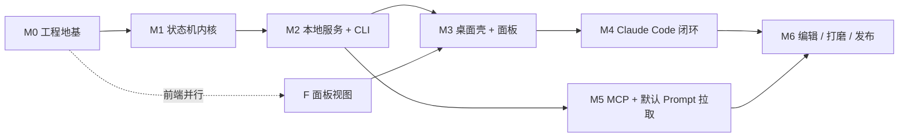

# AgentSOP 任务拆解

> v0.1 · 2026-10-27
> 配套：[技术架构实现文档.md](./技术架构实现文档.md) · [前端设计.md](./前端设计.md) · [checklist.md](./checklist.md)

---

## 0. 拆解原则

1. **每个里程碑结束时系统可运行**，不是半成品堆到最后联调。M1 结束时内核能靠 CLI 跑通；M2 结束能用 curl 跑通；M3 结束能用面板点通。
2. **内核先于外壳**：状态机与事件存储在没有任何 UI 的情况下必须可测。
3. **先闭环再扩展**：Claude Code 一条链路走通（M4）之前，不做 Codex/TRAE 适配。
4. **一条任务一个可验证产出**：DoD 必须能写成命令或一次点击。
5. **不提前优化**：性能预算验证放在 M6，M1-M5 只保证功能正确。

里程碑总览：

关键路径：`M0 → M1 → M2 → M3 → M4 → M6`。M5 可在 M2 完成后与 M3/M4 并行。

---

## M0 · 工程地基

目标：把默认 Tauri 脚手架改造成可长期维护的 workspace，跑通「构建 + 测试 + 空壳启动」。

| ID | 任务 | 产出 | DoD | 依赖 |
|---|---|---|---|---|
| M0-1 | workspace 重构：`crates/core`、`crates/mcp`、`src-tauri` 三成员 | `Cargo.toml` workspace、目录骨架 | `cargo build --workspace` 通过；`agentsop-core` 可被 `src-tauri` 引用 | — |
| M0-2 | 运行目录与配置 | `~/.agentsop` 初始化、`config.toml` 读写、token 生成(0600)、端口文件 | 首次启动后目录存在；重复启动不覆盖已有 token；`ls -l token` 权限为 `-rw-------` | M0-1 |
| M0-3 | 二进制 argv 分派 | `src-tauri/src/main.rs` 在 Tauri 初始化前识别子命令 | `agentsop status` 不启动窗口、不建 tokio GUI runtime；`agentsop` 无参数启动窗口 | M0-1 |
| M0-4 | 前端骨架 | Tailwind + shadcn 初始化、`tokens.css`（light/dark）、`lib/status.ts` 状态映射表、静态 `PanelShell` | `pnpm dev` 下 180 宽面板可见（默认 400 高）；5 种状态色可切换预览 | M0-1 |
| M0-5 | 错误模型与日志 | `AppError`（枚举 + 稳定错误码）、tracing 初始化、日志轮转 | 任意命令失败输出 `{"ok":false,"code":...}`；日志文件 7 天轮转 | M0-2 |
| M0-6 | CI 与本地脚本 | `cargo fmt --check`、`clippy -D warnings`、`test`、`tsc --noEmit`、`vite build` | 一键 `pnpm verify` 全绿；PR 阻断条件配置完成 | M0-1 |

**阶段演示**：`cargo run -p agentsop` 出现托盘图标（即使菜单为空），`agentsop status` 返回「无活跃运行」。

---

## M1 · 状态机内核（无 UI、无 HTTP）

目标：SOP 能加载、能迁移、能回放；完全靠单元测试证明。

| ID | 任务 | 产出 | DoD | 依赖 |
|---|---|---|---|---|
| M1-1 | SOP 模型与校验 | `sop.rs`：serde 模型、`default_prompt` 可选字段、`when` 表达式解析、环检测、路径 jail | 6 类非法 YAML 均返回带行号的错误；合法样例（含 / 不含 `default_prompt`）全部通过 | M0-1 |
| M1-2 | EventStore | `events.jsonl` 追加/读取、原子快照、ULID、`seq` 单调 | 并发追加 1000 条不丢不乱；快照写入失败不留半文件 | M0-2 |
| M1-3 | Kernel actor 与迁移表 | `Command` 枚举、mpsc 消费、§7.1 迁移实现 | 迁移表每一行都有对应单测；非法迁移返回 `INVALID_TRANSITION` | M1-1, M1-2 |
| M1-4 | 完成判定与证据 | 四条完成路径（显式/Hook/产物/人工）、证据记录 | 产物缺失时 Hook 完成事件不推进，只记证据；补齐后下一次事件推进 | M1-3 |
| M1-5 | 回放与崩溃恢复 | `snapshot + events` 重放、`stale` 标记 | 随机 kill 进程后重启，终态与不中断执行一致 | M1-2, M1-3 |
| M1-6 | 渲染器 | `context.md` 渲染（含当前节点 `default_prompt`、≤1.2KB、截断策略）、`current.yaml` 指针 | 超长备注被截断且标记；默认 Prompt 原样可读；中文按 UTF-8 边界截断不产生乱码 | M1-3 |
| M1-7 | 测试套件 | 单测 + `proptest`（增量==重放）+ 3 份录制事件 fixture | `cargo test -p agentsop-core` 全绿；覆盖率（核心模块）≥ 75% | M1-1…M1-6 |

**阶段演示**：一段 `--headless` 脚本按 fixture 注入事件，输出完整节点状态表。

---

## M2 · 本地服务与 CLI

目标：任何外部进程（curl / CLI / 脚本）都能驱动状态机。

| ID | 任务 | 产出 | DoD | 依赖 |
|---|---|---|---|---|
| M2-1 | HTTP 服务与鉴权 | axum router、Bearer 校验、Host/Origin 校验、端口递增与端口文件 | 无 token 返回 401；带 token 返回 200；占用 43117 时自动用 43118 且端口文件正确 | M1-3 |
| M2-2 | REST 端点 | §8 表中全部端点（hooks 除外） | 每个端点有集成测试；非法入参返回稳定错误码 | M2-1 |
| M2-3 | SSE 事件流 | `GET /v1/events?since=` | 断线后带 `since` 重连不丢事件；空闲 30s 发心跳 | M2-2 |
| M2-4 | CLI 命令 | `status/next/start/attach/complete/decide/runs/sop` | `status --json` 可被 `jq` 消费；退出码符合 §10 | M2-2 |
| M2-5 | Hook 子命令与 fail-open | `agentsop hook <source>`：stdin 读取、5s 超时、异常 exit 0 | 服务停止时 exit 0 且无 stdout；stdout 除 JSON 外无任何字符 | M2-4 |
| M2-6 | `doctor` | 端口/token/目录/权限/Agent 探测/路径解析检查 | 输出可读报告；`--json` 可机读；任一异常退出码非 0 | M2-1…M2-5 |
| M2-7 | 服务层测试 | 鉴权、大包、SSE、并发写 | 256KB 以上返回 413；同事件重复提交只迁移一次 | M2-2, M2-3 |

**阶段演示**：终端里 `curl` 创建 run → `agentsop next` → `agentsop decide approve` → `agentsop status` 看到推进。

---

## M3 · 桌面壳与面板

目标：`⌥⌘S` 呼出、不失焦、能看能点。

| ID | 任务 | 产出 | DoD | 依赖 |
|---|---|---|---|---|
| M3-1 | 托盘与单实例 | `LSUIElement`、template 图标、托盘菜单、single-instance | 无 Dock 图标；重复启动只呼出面板；托盘角标显示待决策数 | M0-3 |
| M3-2 | 非激活面板 | `tauri-nspanel` 接入、非激活样式、多空间、vibrancy | 终端聚焦时呼出，终端**仍保持前台**；全屏 App 上可显示 | M3-1 |
| M3-3 | 快捷键与定位 | 全局快捷键注册/冲突提示、默认右侧垂直居中（右边距 24）、跟随鼠标可选、失焦隐藏、pin | 呼出到首帧 <100ms；多屏不越界；宽度固定 180 不随内容变化；有草稿时失焦不隐藏 | M3-2 |
| M3-4 | IPC 契约 | §14 全部 command + event | 前端调用无 any；错误码可映射到 toast；snapshot 节流 20/s | M2-2 |
| M3-5 | 主视图接线 | 两行顶栏、轨道、节点卡、默认 Prompt 卡、决策栏、底栏接真实 Snapshot | 用 fixture run 展示 5 种状态；点击节点切换详情；默认 Prompt 卡在产物前 | M0-4, M3-4 |
| M3-6 | 密度与动效 | 4 档高度、过渡、reduced-motion | 状态变化时高度按规则切换；手动滚动后不自动切 | M3-5 |

**阶段演示**：面板上点击「通过」，终端里的 `agentsop status` 同步变化。

---

## M4 · Claude Code 闭环（首期核心价值）

目标：AI 干完自动推进；人工卡点真的拦得住；人的决定真的送得到。

| ID | 任务 | 产出 | DoD | 依赖 |
|---|---|---|---|---|
| M4-1 | Claude 适配器 | stdin JSON 解析、8 类 Hook → 内核事件映射 | 8 类样例逐条单测；未知 Hook 走 generic 分支不报错 | M2-5 |
| M4-2 | hooks 安装器 | `install/uninstall/status`，merge + 备份 + `--dry-run` + 幂等 | 连续安装两次配置不变；卸载只移除 `_agentsop` 项；备份可还原 | M4-1 |
| M4-3 | Guard 策略 | `PreToolUse` deny 判定、理由模板、`override_once` | 待决策节点下 `git commit` 被 deny；通过后同一命令放行；理由包含人的备注 | M2-2, M4-1 |
| M4-4 | 上下文注入 | `SessionStart` / `UserPromptSubmit` 返回 `additionalContext`（含当前节点默认 Prompt） | 决策后下一轮 prompt 含决策文本；节点轮转后含 `default_prompt`；无内容时不注入（保持静默） | M1-6, M4-1 |
| M4-5 | 会话绑定与并发锁 | `session_id → run` 绑定、节点抢占、`advisory` 标记 | 两个会话操作同一节点时，后者只记证据；面板提示冲突 | M1-3, M4-1 |
| M4-6 | 真实链路验证 | 用真实 Claude Code 跑 3 节点 SOP 的脚本与录屏 | 见 checklist E2E-1：Stop 后 500ms 内节点 done；拦截生效；决策一轮内可见 | M4-2…M4-5 |

**阶段演示**：Claude Code 里说「按 SOP 开始」，面板自动亮起并随 AI 完成逐步推进，人点「打回」后 AI 下一轮改稿。

---

## M5 · MCP 与默认 Prompt 拉取

目标：Agent 能主动自检、主动拉取默认 Prompt 与人的决定；不承载对话。

| ID | 任务 | 产出 | DoD | 依赖 |
|---|---|---|---|---|
| M5-1 | MCP 骨架 | stdio JSON-RPC、`initialize`、`tools/list`、错误处理 | MCP Inspector 握手成功，无 stdout 污染 | M2-4 |
| M5-2 | 7 个工具 | §11 工具表全部实现（含 `sop_next` 返回当前节点 `default_prompt`） | 每个工具有成功/失败样例；`SERVICE_DOWN` 不崩溃；`sop_next` 能取到默认 Prompt | M5-1, M2-2 |
| M5-3 | 资源 | `run/context`、`run/snapshot`、`sop/{name}` | 资源内容与 HTTP 端点逐字节一致，context 含默认 Prompt | M5-2 |
| M5-4 | 长轮询决策 | `sop_request_decision(blocking=true)` 90s 挂起 | 挂起期间人决策 → 立即返回；超时返回 `pending` 且可续 | M5-2 |
| M5-5 | MCP 安装与文档 | 配置写入、`agentsop mcp` 入口、使用示例 | Claude Code 中 `sop_status` / `sop_next` 可调用；卸载残留为零 | M5-1 |

**阶段演示**：在 Claude Code 里让 Agent 调 `sop_request_decision`，面板弹出问题卡，回答后 Agent 继续；`sop_next` 返回当前节点默认 Prompt。

---

## M6 · 编辑、打磨与发布

目标：可交付给非开发者使用；性能、可访问性、签名公证达标。

| ID | 任务 | 产出 | DoD | 依赖 |
|---|---|---|---|---|
| M6-1 | SOP 表单编辑器 | 面板内浮层（固定 720）、顶部 select 选节点、单列表单、默认 Prompt 字段、字段校验、YAML diff 预览、保存热重载 | 保存非法 SOP 被拒且定位到字段；活跃运行时禁用编辑；默认 Prompt 可写入 YAML | M3-5, M2-2 |
| M6-2 | 完善态 | 空态、断连、无产物、advisory、事件洪峰 | 前端设计 §12 全部场景可达且不崩 | M3-5 |
| M6-3 | 可访问性与键盘 | 焦点环、`aria-live`、`aria-current`、IME 安全、`?` 帮助 | 全流程不碰鼠标可完成一次决策；中文输入法下不误触 | M3-5 |
| M6-4 | 性能预算验证 | 启动/呼出/Hook 延迟/内存/包体积测量 | 技术架构 §17 全部达标或给出书面豁免 | M4-6, M5-4 |
| M6-5 | 打包与分发 | 签名、公证、DMG、shim 安装、登录启动 | 干净机器双击可启动；Gatekeeper 不拦；`/usr/local/bin/agentsop` 可用 | M6-4 |
| M6-6 | Onboarding 与文档 | 首启引导、hooks 未安装提示、README、故障排查 | 新用户 3 分钟内完成「装 hooks → 跑通一个节点」 | M6-2 |
| M6-7 | 发布门禁 | 执行 checklist 全部条目 | 无未闭合 P0/P1；已知问题清单归档 | 全部 |

**阶段演示**：在一台未装过开发环境的 Mac 上，从 DMG 安装到跑通一个 SOP。

---

## 并行泳道建议

| 泳道 | 覆盖任务 | 说明 |
|---|---|---|
| 内核 | M0-1…M1-7、M2-1…M2-3 | 纯 Rust，可与前端完全并行 |
| 前端 | M0-4、M3-5、M3-6、M6-1…M6-3 | 依赖 IPC 契约（M3-4）冻结后可并行 |
| 集成 | M2-4…M2-7、M4、M5 | 需要真实 Agent 环境，建议固定一台机器 |
| 发布 | M6-4…M6-7 | 最后收敛，但签名/公证证书需提前申请 |

契约冻结点：**M3-4 完成时冻结 `Snapshot` 与 IPC 契约**，之后只允许加字段。前端与桌面壳据此并行。

---

## 明确不做（首期 backlog 排除项）

- 图形化流程画布、自动布局、模板市场。
- Codex / TRAE 的完整适配（仅保留 `hook codex` 与 generic 入口，不做配置写入）。
- 云端同步、团队空间、审批流。
- 自动 git commit / 自动发版。
- 多运行并行推进（首期同 run 串行，可开多个 run 但一次只推一个）。
- 移动端 / Windows / Linux 面板。
- 多语言（仅中文；文案集中在一个文件，便于后续抽取）。

---

## 风险与任务级缓解

| 风险 | 最先暴露于 | 缓解动作 |
|---|---|---|
| 非激活面板 API 不稳定 | M3-2 | 第一天做技术验证性 spike；失败即切降级方案，并更新前端「失焦」逻辑 |
| Claude hooks 字段与预期不符 | M4-1 | 先用真实会话抓 8 类 hook JSON 存档，再写解析 |
| Hook 5s 超时 | M2-5 / M4-6 | 从 M2 起就压测；落盘异步化；超时日志可观测 |
| 注入上下文被 Agent 忽略 | M4-4 / M4-6 | 以 Guard 阻断为主、注入为辅；E2E 中统计「决策可见率」 |
| 面板与编辑器快捷键冲突 | M3-3 | 默认可改键；冲突时托盘提示，不静默失败 |
| SOP 校验过于宽松 | M1-1 | 非法样例先行（测试驱动），环检测与路径 jail 必须单测 |
| 状态文件膨胀 | M1-2 / M6-4 | 快照 + 事件只保留必要字段；默认 Prompt 等长文本只存 SOP 定义，不进事件流 |

---

## 每里程碑的完成仪式（避免假完成）

1. `pnpm verify` 全绿。
2. 用**干净账户**（无 `~/.agentsop`）跑一遍启动。
3. 录 30 秒演示，覆盖本里程碑新增能力。
4. 更新 [checklist.md](./checklist.md) 对应分组。
5. 列出本里程碑产生的「已知问题」，写入仓库 `KNOWN_ISSUES.md`（仅记录，不修）。
