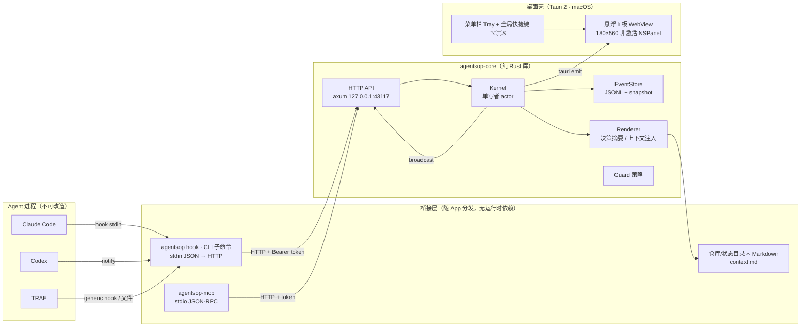
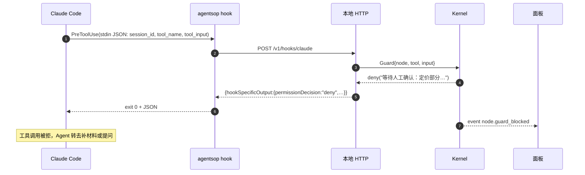
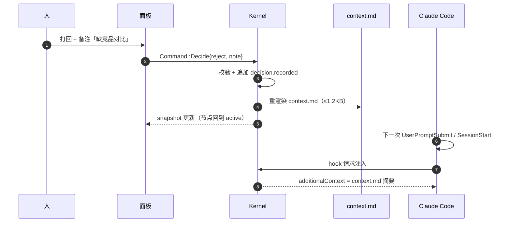

# AgentSOP 技术架构实现文档

> v0.1 · 2026-10-27 · 对应仓库 `agentsop`
> 配套文档：[前端设计.md](./前端设计.md) · [任务拆解.md](./任务拆解.md) · [checklist.md](./checklist.md)

---

## 0. 一句话定义

不改 TRAE / Codex / Claude Code 的任何 UI：用一个常驻菜单栏的窄面板承载 SOP 状态机，用本地 HTTP + Hook 接收「AI 已完成」，用状态文件 / MCP 把「人的决定」回灌给 Agent，形成一个不抢戏但握得住整条流程的控制条。

---

## 1. 目标与非目标

### 1.1 目标（验收口径）

| 编号 | 目标 | 可测量口径 |
|---|---|---|
| G1 | 全流程可视化 | 任意时刻面板一屏内看到：运行名、全部节点状态、当前节点、谁在等谁、下一步 |
| G2 | AI 完成自动推进 | Agent 正常结束后，节点状态在 500ms 内变为 `done`，无需人工点击 |
| G3 | 人工卡点不可绕过 | 人工节点未决策时，被 Guard 覆盖的工具调用被 deny（Claude Code / Codex / TRAE 场景） |
| G4 | 决策回灌 | 决策后，Agent 下一轮交互（≤1 轮）能看到决策内容 |
| G5 | 默认 Prompt 自动填入 | 节点轮转到时，`default_prompt` 在 `context.md` / HTTP 上下文 / MCP 下一次拉取（≤1 轮）中可读 |
| G6 | 零 UI 侵入 | 仅使用 Agent 官方 hooks / MCP / 配置文件 / 仓库内文件，不注入其界面 |
| G7 | 低存在感 | 无 Dock 图标；冷点快捷键到面板可见 < 100ms；常驻内存 < 120MB |

### 1.2 非目标（首期明确不做）

- 不做云端同步、多用户协作、团队权限。
- 不负责调用模型、管理 token 预算、代理 Agent 请求。
- 不做图形化流程编排画布（只做**表单式**编辑，YAML 是唯一真相）。
- 不假设 Agent 提供 hooks 之外的阻断能力；三端均通过官方 command hook 实现阻断（见 §9）。
- 不支持 Windows / Linux 的非激活面板；跨平台仅保留窗口级降级实现。
- 不做自动 git 提交、自动改代码等「代做」能力。

---

## 2. 约束与设计原则

| 编号 | 约束 | 落地手段 |
|---|---|---|
| C1 | 不能改 Agent UI | 只走 hooks / MCP / 配置文件 / 仓库文件；面板是独立进程 |
| C2 | 绝不能卡住开发者 | Hook 入口默认 **fail-open**：服务不可达、超时、异常一律静默放行（exit 0，无输出） |
| C3 | 本地优先、不出网 | HTTP 只绑 `127.0.0.1`；无遥测；无云依赖 |
| C4 | 状态只有一个写入者 | Kernel 是单写者 actor，所有变更串行化并通过 mpsc 提交 |
| C5 | 可回放、可审计 | 事件溯源（append-only JSONL）+ 周期快照；启动时重放 |
| C6 | 四级降级 | Hook 推送 → MCP 拉取 → 文件被动读 → 人工点选，任一失效不影响流程继续 |
| C7 | 状态必须可被外部消费 | 一切状态同时暴露为 CLI 输出、JSON 快照、Markdown 摘要 |
| C8 | 意图可读优先于功能多 | 每个交互两跳内可达；默认不自动弹窗 |

---

## 3. 系统总览



三层职责：

1. **内核层（agentsop-core）**：SOP 定义解析、状态机、事件存储、渲染。无 UI 依赖，可独立跑测试与 CLI。
2. **桥接层**：把各 Agent 的异构事件规整成统一信封；把人的决定以三种通道回灌。
3. **桌面壳层**：只做「窗口 + 快捷键 + 托盘 + WebView 渲染」，不含业务逻辑。

### 3.1 关键时序：Guard 阻断



### 3.2 关键时序：决策回灌



---

## 4. 进程与产物模型

决策：**同一 Cargo workspace，共享 `agentsop-core`，对外两个可执行入口，无任何运行时依赖（不需要 Node/Python）。**

| 产物 | 形态 | 说明 |
|---|---|---|
| `agentsop` | Tauri GUI 二进制 | 无参数启动 → 菜单栏常驻；带子命令（`status`/`decide`/`hook`/…）→ 纯 CLI 模式，**不初始化 Tauri**，冷启动 < 30ms |
| `agentsop-mcp` | 独立 stdio 二进制 | 必须独立进程：MCP 客户端按需 spawn，生命周期与 GUI 解耦 |

为什么 CLI 合进 GUI 二进制：满足「单二进制」诉求，且 CLI 与 GUI 共享 schema/渲染代码，避免双份实现漂移。
为什么 MCP 必须独立：stdio JSON-RPC 独占 stdin/stdout，且会被 Agent 以子进程方式反复拉起，不能带上 Tauri 运行时。

安装形态：

```
/Applications/AgentSOP.app/Contents/MacOS/agentsop
/Applications/AgentSOP.app/Contents/MacOS/agentsop-mcp
/usr/local/bin/agentsop      → shim 脚本（exec 绝对路径，规避符号链接导致的资源解析问题）
/usr/local/bin/agentsop-mcp  → shim 脚本
```

> `agentsop hook ...` 在 Agent 配置中**写绝对路径**（安装时解析），避免 PATH 差异导致 Hook 静默失效。

---

## 5. 目录与文件布局

```
~/.agentsop/
├── config.toml                 # 端口、快捷键、隐私、自动弹出策略
├── token                       # 0600，HTTP Bearer token
├── run/
│   ├── port                    # 实际监听端口（端口冲突时递增）
│   └── pid
├── sops/
│   ├── prd-to-ship.yaml        # SOP 定义（可入 Git）
│   └── hotfix.yaml
├── runs/
│   └── run_7f3a2c/
│       ├── meta.json           # run 元信息、repo cwd、绑定 session、SOP 版本
│       ├── events.jsonl        # 事件溯源主数据
│       ├── snapshot.json       # 物化快照（每 50 事件或节点完成时写）
│       ├── context.md          # 渲染给 Agent 的决策与默认 Prompt 摘要（≤1.2KB）
│       └── artifacts/          # 证据快照（文件路径、测试输出摘要）
└── logs/
    └── agentsop-YYYYMMDD.log
```

仓库侧（`agentsop init --repo <path>` 一次性写入，可 `.gitignore`）：

```
<repo>/.agentsop/
├── current.yaml                # 只读指针：run_id / sop / current_node
├── context.md                  # 与 ~/.agentsop/runs/<id>/context.md 同步
└── README.md                   # 给 Agent 的一行说明：先读 context.md
```

仓库内文件是**被动通道**：即使 Hook 与 MCP 全部失效，Agent 只要按 AGENTS.md/CLAUDE.md 指引读取，就能看到人的最新决定。

---

## 6. 数据模型

### 6.1 SOP 定义（YAML 为唯一真相）

```yaml
sop: prd-to-ship
version: 1
title: 从需求到上线
vars:
  repo: "."
  branch: "feature/sop"

entry: clarify
nodes:
  - id: clarify
    type: human
    title: 需求澄清
    prompt: "确认目标用户、范围边界、验收标准"
    blocking: true              # 未决策时 Guard 拦截写操作

  - id: analyze
    type: agent
    title: 需求分析
    agent: claude-code
    default_prompt: "/analysis 分析 docs/interview.md"
    done:
      events: [Stop]
      artifacts: ["docs/analysis.md"]

  - id: draft_prd
    type: agent
    title: 起草 PRD
    agent: claude-code
    default_prompt: "/draft-prd 基于 docs/interview.md 起草 PRD"
    context:
      include: [clarify, analyze]
      extra: "输出到 docs/prd.md，不要动其它章节"
    done:
      events: [Stop]            # 命中 Claude Code Stop 事件
      artifacts: ["docs/prd.md"]  # 且文件存在
    review: true                # 完成后自动插入人工确认（隐式 human 节点）
    guard:
      deny: ['Bash(git commit:*)', 'Bash(git push:*)']

  - id: build
    type: agent
    title: 实现
    agent: claude-code
    done:
      events: [Stop]
      artifacts: ["pnpm-lock.yaml"]

  - id: verify
    type: auto
    title: 本地校验
    action:
      shell: "pnpm tsc --noEmit"
      timeout_sec: 120

  - id: release
    type: human
    title: 发布确认
    prompt: "检查变更清单，确认可发布"
    blocking: true

edges:
  - { from: clarify,     to: analyze }
  - { from: analyze,     to: draft_prd }
  - { from: draft_prd,   to: build,   when: "review.approved" }
  - { from: draft_prd,   to: draft_prd, when: "review.rejected", kind: retry, max: 3 }
  - { from: build,       to: verify }
  - { from: verify,      to: release }
  - { from: verify,      to: build,   when: "verify.failed", kind: retry, max: 2 }
```

字段约束：

| 字段 | 必填 | 说明 |
|---|---|---|
| `sop` / `version` / `entry` | 是 | `version` 为 schema 大版本；高于内核支持版本直接拒绝加载 |
| `nodes[].id` | 是 | `^[a-z][a-z0-9_]{1,39}$`，全局唯一 |
| `nodes[].type` | 是 | `human` \| `agent` \| `auto` |
| `nodes[].default_prompt` | 否 | 默认 Prompt，仅 `agent` 节点有意义；节点轮转到时自动填入并渲染给 Agent，`human` / `auto` 节点忽略 |
| `nodes[].blocking` | 否 | 默认 `false`；`true` 时启用 Guard 阻断 |
| `nodes[].done.artifacts` | 否 | 相对 `vars.repo` 的路径，必须落在仓内 |
| `nodes[].guard.deny` | 否 | 工具匹配表达式；`Bash` / `RunCommand` / `Shell` / `exec_command` 视为同类，Claude Code / Codex / TRAE 通用 |
| `edges[].kind` | 否 | `normal` \| `retry`；`retry` 必须有 `max` |
| `edges[].when` | 否 | 条件表达式，见 §7.2 |

校验规则（加载即失败，给出行号）：id 唯一、`entry` 存在、无环（`retry` 边不参与环检测）、所有 `to` 可达、`artifacts` 不含 `..` 与绝对路径。

### 6.2 事件信封（Hook 统一入参）

```json
{
  "schema": 1,
  "event_id": "01J9Z6K3T9VQ2R8N5M4P1X7C0B",
  "source": "claude-code",
  "session_id": "cc_8f1c...",
  "run_id": "run_7f3a2c",
  "type": "agent.completed",
  "node_id": "draft_prd",
  "ts": "2026-10-27T07:31:02Z",
  "payload": {
    "hook_event_name": "Stop",
    "tool_name": null,
    "cwd": "/Users/me/repo",
    "artifacts": ["docs/prd.md"],
    "summary": "已生成 PRD 初稿"
  }
}
```

- `event_id`：ULID，由发送端生成；内核用它对**同 run 内**去重（保留最近 2000 条 ID）。
- `ts` 仅用于展示与审计；排序一律用内核自增 `seq`，避免时钟漂移。
- `payload` 有 4KB 上限，超长截断并标记 `truncated: true`。
- 三端实际透传字段均为 `hook_event_name`（`SessionStart` / `UserPromptSubmit` / `PreToolUse` / `PostToolUse` / `Stop`，Claude 另有 `SubagentStop`）；内核同时兼容自定义来源使用 `hook_event`。`agentsop hooks install [claude-code|codex|trae]` 会一次性写入对应事件，命令分别为 `agentsop hook claude-code|codex|trae`。

### 6.3 内核事件类型（写入 events.jsonl）

| type | 触发者 | 含义 |
|---|---|---|
| `run.created` | system | 运行创建，记录 SOP 版本与 cwd |
| `run.paused` / `run.resumed` / `run.completed` / `run.aborted` | human | 运行级控制 |
| `node.entered` | system | 节点成为当前节点 |
| `node.evidence` | agent | 证据入库（工具产出、文件、测试摘要），不迁移 |
| `node.completed` | agent / human / system | 节点完成 |
| `node.blocked` | system / human | 阻塞（Guard 拒绝、校验失败、重试超限） |
| `node.retried` | human / system | 打回重做，计数 +1 |
| `node.stale` | system | 超时未结束（默认 30min） |
| `decision.recorded` | human | `approve` / `reject` / `retry` / `abort` + note |
| `session.attached` | agent | Agent 会话与 run 绑定 |
| `sop.reloaded` | human | SOP 定义热更新：保存后立即回灌 running/paused 的运行（标题、节点、默认 Prompt 同步） |

### 6.4 决策模型

```rust
struct Decision {
    id: String,
    node_id: String,
    action: DecisionAction, // Approve | Reject | Retry | Abort
    note: String,           // Reject 必填，且 ≥ 8 字
    author: String,         // 本机用户名
    ts: DateTime<Utc>,
}
```

决策 = 改变状态机，进入 `events.jsonl` 的 `decision.recorded`；AgentSOP 不承载对话，Agent 侧的交流由 Agent Tool 自身完成。

---

## 7. 状态机内核

### 7.1 节点状态与迁移

节点状态：`pending` → `ready` → `active`（`agent`/`auto`）或 `waiting_human`（`human`）→ `done` / `blocked` / `skipped` / `stale`。

| 当前 | 触发 | 守卫 | 结果 |
|---|---|---|---|
| `pending` | 上游 `node.completed` 且入边条件成立 | 无条件边或 `when` 为真 | `ready` |
| `ready` | 内核调度 | 同 run 内无其它 `active` 节点（首期串行） | `active` / `waiting_human` |
| `active`(agent) | `agent.completed` | session 绑定匹配 且 `artifacts` 全部存在 | `done` |
| `active`(agent) | `agent.evidence` | 规则命中 | 记录证据，**不迁移** |
| `waiting_human` | `decision.approve` | 无 | `done` |
| `waiting_human` | `decision.reject` | `note` 非空且 ≥8 字 | 回到 `active`，`retry+1` |
| 任意 | `node.blocked` | — | `blocked` |
| `blocked` | `decision.retry` | 人确认 | `active`，`retry+1` |
| `active`(auto) | 动作返回 | exit code == 0 | `done`；否则 `blocked` |
| `active`/`waiting_human` | 超时（30min，可配） | 无更新 | `stale`（不自动跳过，等人处理） |
| `done` | 所有后继已处理 | — | run 完成判定 |

运行状态：`running | paused | completed | aborted`。`paused` 时仍接收 hook（记录证据）但不推进节点——用于人临时接管。

`when` 表达式仅支持有限文法，避免任意脚本执行：

```
when := term (("and"|"or") term)*
term := ident "." ident ("=="|"!=") (string|number|bool)
ident := "review" | "verify" | <node_id>
```

例：`review.approved`、`verify.failed`、`build.retry < 3`。

### 7.2 完成判定（agent 节点）

四选一，优先级从高到低：

1. 显式完成：`POST /v1/nodes/:id/complete`（CLI `agentsop complete` 或 MCP `sop_complete_node`）。
2. Hook 命中：事件类型在 `done.events` 白名单内，且 `session_id` 与该节点绑定会话一致。
3. 产物齐备：`done.artifacts` 全部存在且 mtime 晚于节点 `entered_at`（用于无 Stop 事件的 Agent）。
4. 人工标记：面板「完成此节点」按钮（兜底）。

> 1 与 2 都满足时视为同一事实，靠 `event_id` 去重，不产生二次迁移。

### 7.3 并发、幂等与多 Agent

- 所有命令进入 `mpsc::channel(256)`，Kernel 单任务消费，天然串行。
- `session_id → run_id` 绑定表存于 `meta.json`；首个来自 `cwd` 的 hook 自动绑定，重绑定需在面板手动确认。
- 同一 run 同节点被两个 session 争夺时：先到者持锁（`node.active_session`），后来者的事件记为 `evidence` 并在面板提示「另一会话在想同一节点」。
- 命令携带 `expected_seq`（可选）；不匹配返回 `409 CONFLICT`，UI 自动刷新后重试。

### 7.4 回放与快照

- 启动时读 `snapshot.json`，再重放 `events.jsonl` 中 `seq > snapshot.seq` 的部分。
- 快照策略：每 50 个事件、或每次 `node.completed`、或退出前，原子写（写临时文件 + rename）。
- 重放必须**确定性**：所有决策输入都在事件里（含 `now`），不使用当前时间影响迁移结果。

### 7.5 拒绝语义

所有非法操作返回结构化原因，面板以 toast 展示，不静默失败：

```json
{ "ok": false, "code": "STATE_CONFLICT", "message": "节点 draft_prd 已由会话 A 完成", "snapshot_seq": 128 }
```

错误码：`RUN_NOT_FOUND` / `NODE_NOT_FOUND` / `STATE_CONFLICT` / `INVALID_TRANSITION` / `SOP_INVALID` / `SERVICE_DOWN` / `FORBIDDEN` / `PAYLOAD_TOO_LARGE`。

---

## 8. 本地 HTTP 服务

- 框架：`axum 0.8` + `tokio`；只绑 `127.0.0.1`。
- 端口：默认 `43117`，被占用时在 `43117..43127` 内递增，实际端口写入 `~/.agentsop/run/port`；CLI 永远先读端口文件，不硬编码。
- 认证：除 `/v1/health` 外全部要求 `Authorization: Bearer <token>`。CLI / MCP 自行读取 token 文件（0600），Agent 配置里不出现 token。
- 限制：请求体 ≤ 256KB；`Content-Type: application/json`；拒绝带 `Origin` 且非 `tauri://localhost` 的请求（防浏览器 CSRF）。

| 方法 | 路径 | 用途 | 返回 |
|---|---|---|---|
| GET | `/v1/health` | 探活 | `{ok, version, port, active_run}` |
| GET | `/v1/state?run_id=` | 完整快照 | `Snapshot` |
| GET | `/v1/context?run_id=` | Markdown 摘要（含当前节点默认 Prompt，同 `context.md`） | `text/markdown` |
| GET | `/v1/events?since=seq` | SSE 增量事件流 | `text/event-stream` |
| POST | `/v1/runs` | 创建运行 `{sop, repo, vars}` | `{run_id, snapshot}` |
| POST | `/v1/runs/:id/attach` | 会话绑定 `{session_id, cwd}` | `{run_id}` |
| POST | `/v1/runs/:id/pause` \| `/resume` \| `/abort` | 运行控制 | `Snapshot` |
| POST | `/v1/runs/:id/session` | 绑定会话，`{ "session_id": "..." }`；绑定后只接受该会话的 hook | `Snapshot` |
| POST | `/v1/nodes/:id/complete` | 显式完成 `{evidence[]}` | `Snapshot` |
| POST | `/v1/decisions` | 记录决策 `{node_id, action, note}` | `Snapshot` |
| POST | `/v1/hooks/claude` | Claude Code 专用适配（含阻断语义） | Claude hook JSON |
| POST | `/v1/hooks/:source` | 通用适配 `{...}` | `{action}` |
| POST | `/v1/sops` | 保存 SOP（写 YAML，原子替换，写完校验） | `{ok}` |

SSE 示例：

```
event: node.completed
id: 128
data: {"seq":128,"run_id":"run_7f3a2c","node_id":"draft_prd","status":"done"}
```

面板**不订阅 SSE**（走 Tauri event，见 §14），SSE 供 CLI watch 与外部脚本使用。

---

## 9. Agent 桥接层

### 9.1 能力矩阵（实测情况）

| 能力 | Claude Code | Codex | TRAE |
|---|---|---|---|
| 会话开始注入上下文 | ✅ SessionStart | ✅ SessionStart | ✅ SessionStart |
| 每轮提示注入 | ✅ UserPromptSubmit | ✅ UserPromptSubmit | ✅ UserPromptSubmit |
| 工具调用前阻断 | ✅ PreToolUse deny | ✅ PreToolUse deny | ✅ PreToolUse deny |
| 工具调用后取证 | ✅ PostToolUse | ✅ PostToolUse | ✅ PostToolUse |
| 完成通知 | ✅ Stop / SubagentStop | ✅ Stop | ✅ Stop |
| 反向提问（Agent→人） | ✅ MCP | ✅ MCP | ✅ MCP |
| 强制推进方式 | Hook 阻断 + 注入 | Hook 阻断 + 注入 | Hook 阻断 + 注入 |

> 三端都能做到「可阻断 + 可注入」，输出协议一致（`hookSpecificOutput.permissionDecision` / `additionalContext`）。差异只在 shell 工具名（Claude/Codex 为 `Bash`，TRAE 为 `RunCommand`）与会话事件细节，Guard 在匹配时把 `Bash` / `RunCommand` / `Shell` / `exec_command` 归一为同一类，SOP 里继续写 `Bash(git commit:*)` 即可跨 Agent 生效。

### 9.2 Claude Code 适配

安装命令：

```bash
agentsop hooks install claude-code      # 写入 ~/.claude/settings.json
agentsop hooks status claude-code
agentsop hooks uninstall claude-code
```

写入 `~/.claude/settings.json`，**合并而非覆盖**，按 command 中含 `agentsop hook` 识别并替换旧条目；写入前备份 `settings.json.agentsop.bak`，`--dry-run` 只打印结果不落盘。

```json
{
  "hooks": {
    "SessionStart": [{ "hooks": [{ "type": "command", "command": "…/agentsop hook claude-code", "timeout": 10 }] }],
    "UserPromptSubmit": [{ "hooks": [{ "type": "command", "command": "…/agentsop hook claude-code", "timeout": 10 }] }],
    "PreToolUse": [{ "hooks": [{ "type": "command", "command": "…/agentsop hook claude-code", "timeout": 10 }] }],
    "PostToolUse": [{ "hooks": [{ "type": "command", "command": "…/agentsop hook claude-code", "timeout": 10 }] }],
    "Stop": [{ "hooks": [{ "type": "command", "command": "…/agentsop hook claude-code", "timeout": 10 }] }],
    "SubagentStop": [{ "hooks": [{ "type": "command", "command": "…/agentsop hook claude-code", "timeout": 10 }] }]
  }
}
```

不设置 `matcher`（等价于匹配所有工具），由内核 Guard 决定 allow/deny，避免 Agent 侧正则与 SOP 表达式两套规则。

事件映射：

| Claude Hook | 内核动作 | 返回给 Claude |
|---|---|---|
| `SessionStart` | 执行 `session.attached`；若 cwd 命中单活跃 run 则自动绑定 | `hookSpecificOutput.additionalContext` = 当前节点 + 默认 Prompt + 人的决定摘要 |
| `UserPromptSubmit` | 记录 prompt 摘要（默认不存全文）；重渲染上下文 | 有未读决策时 `additionalContext` = 增量摘要；否则空 |
| `PreToolUse` | `Guard{node, tool, input}` | allow → 无输出；deny → `permissionDecision:"deny"` + 理由 |
| `PostToolUse` | `node.evidence`（文件路径、退出码、输出前 512 字） | 无 |
| `Stop` | 匹配 `done.events` → `node.completed` | 正常空输出 |
| `SubagentStop` | 记证据，不推进主节点 | 无 |
| `Notification` | 面板提示（权限请求 / 空闲 / 等待输入） | 无 |
| `SessionEnd` | 若节点仍 `active`，10s 后标记 `stale` | 无 |

实现要点：

- stdin 读取上限 512KB；非 JSON 或字段缺失 → 直接 exit 0（fail-open）。
- 必须在 **5s** 内返回，否则 Agent 侧会超时；内核路径全程无磁盘 fsync 阻塞（先入 channel，异步落盘）。
- 输出必须**只有** JSON，日志一律写 stderr + 文件，否则会被 Claude 解析失败。

Guard 默认策略（可在 SOP 覆盖）：

1. 当前 `waiting_human` 且 `blocking: true` → 拒绝 `Bash(git commit:*)`、`Bash(git push:*)`、`Bash(gh pr create*)`。
2. 节点声明了 `guard.deny` → 逐条匹配。
3. 其它一律放行（避免误伤）。

拒绝理由必须**可执行**，模板：

```
AgentSOP 拦截：节点「起草 PRD」在等待人工确认。
人的意见：定价部分缺少竞品对比。
下一步：补充竞品定价对比后再提交；不要改动其它章节。
（查看：agentsop status）
```

### 9.3 Codex 适配

Codex CLI 0.152+ 提供完整 hooks（`PreToolUse` / `PostToolUse` / `SessionStart` / `UserPromptSubmit` / `Stop` 等），输入输出与 Claude Code 兼容。

安装：

```bash
agentsop hooks install codex
agentsop mcp install codex
```

1. 写 `~/.codex/hooks.json`（合并、备份 `hooks.json.agentsop.bak`），命令为 `…/agentsop hook codex`。
2. 在 `~/.codex/config.toml` 的 `[features]` 段确保 `codex_hooks = true`（缺失则自动插入，并备份 `config.toml.agentsop.bak`）。
3. MCP 通过官方 CLI 注册：`codex mcp add agentsop -- <绝对路径>/agentsop-mcp`，写入 `[mcp_servers.agentsop]`；卸载用 `codex mcp remove agentsop`。

```json
{
  "hooks": {
    "SessionStart": [{ "hooks": [{ "type": "command", "command": "…/agentsop hook codex", "timeout": 10 }] }],
    "UserPromptSubmit": [{ "hooks": [{ "type": "command", "command": "…/agentsop hook codex", "timeout": 10 }] }],
    "PreToolUse": [{ "hooks": [{ "type": "command", "command": "…/agentsop hook codex", "timeout": 10 }] }],
    "PostToolUse": [{ "hooks": [{ "type": "command", "command": "…/agentsop hook codex", "timeout": 10 }] }],
    "Stop": [{ "hooks": [{ "type": "command", "command": "…/agentsop hook codex", "timeout": 10 }] }]
  }
}
```

要点：

- Codex 的 shell 工具名固定为 `Bash`，`tool_input.command` 携带命令；PreToolUse 返回 `hookSpecificOutput.permissionDecision:"deny"` 即可拦截。
- 旧的 `notify`（仅整轮结束触发）仍可作为兜底，但不再是主通道。
- Codex 首次运行新 hook 可能要求用户信任（内部记录 `[hooks.state]` 哈希），属正常安全提示。

### 9.4 TRAE 适配

TRAE 支持全局与项目两级 command hook，schema 与 Claude Code 高度相似但多一个顶层 `version`。

安装：

```bash
agentsop hooks install trae      # 写 ~/.trae-cn/hooks.json（全局）
agentsop mcp install trae        # 写 …/Trae CN/User/mcp.json
```

```json
{
  "version": 1,
  "hooks": {
    "SessionStart": [{ "hooks": [{ "type": "command", "command": "…/agentsop hook trae", "timeout": 10 }] }],
    "UserPromptSubmit": [{ "hooks": [{ "type": "command", "command": "…/agentsop hook trae", "timeout": 10 }] }],
    "PreToolUse": [{ "hooks": [{ "type": "command", "command": "…/agentsop hook trae", "timeout": 10 }] }],
    "PostToolUse": [{ "hooks": [{ "type": "command", "command": "…/agentsop hook trae", "timeout": 10 }] }],
    "Stop": [{ "hooks": [{ "type": "command", "command": "…/agentsop hook trae", "timeout": 10 }] }]
  }
}
```

要点：

- shell 工具名是 `RunCommand`，内核 Guard 已把它与 `Bash` 归一。
- stdin 含 `session_id` / `cwd` / `workspace_roots` / `hook_event_name`，与内核解析一致。
- 全局 Hook 对所有工作区生效；只想作用于当前项目时，把同样的 `hooks` 段写入 `<repo>/.trae/hooks.json`。
- TRAE 的 Hook 默认在**沙箱**中运行，会限制文件访问；而 `agentsop hook` 需要读取 `~/.agentsop/port`、`~/.agentsop/token` 才能访问本地 HTTP。因此请在 TRAE 的 Hook 设置里把 AgentSOP 的 hook 运行方式改为「本地自动运行」，否则 hook 会 fail-open（不阻塞，但也不推进状态）。
- TRAE 也会读取 Claude Code 的 hook 配置；两种配置并存时会合并执行，因此不必重复安装到两个位置。
- MCP 写入 `~/Library/Application Support/Trae CN/User/mcp.json` 的 `mcpServers.agentsop`，保留已有 server 条目。

### 9.5 三条回灌通道（人的决定 → Agent）

| 通道 | 载体 | 时效 | 依赖 |
|---|---|---|---|
| A 推送 | Hook `additionalContext`（Claude 专属） | 下一轮立即 | Hook 已装 |
| B 拉取 | MCP `sop_context` / `sop_status` 工具 | Agent 主动调用 | 配好 MCP server |
| C 被动 | `<repo>/.agentsop/context.md` + `AGENTS.md`/`CLAUDE.md` 一行指引 | 下次读取 | 只需文件 |

`context.md` 渲染模板（严格 ≤1.2KB，超出按优先级截断）：

```markdown
[AgentSOP] run=run_7f3a2c sop=prd-to-ship node=draft_prd (agent)
状态: 等待人工确认（第 2 次提交）
默认 Prompt: /draft-prd 基于 docs/interview.md 起草 PRD
人的决定: 打回 — 定价部分缺少竞品对比
必须做: 补充竞品定价对比表；不要改动其它章节
下一步: 完成后自动进入 build
更新于: 2026-10-27 15:31:02 +08:00
```

三条通道共用同一渲染结果（三条通道均携带当前节点 `default_prompt`），保证 Agent 无论从哪条路读到的都是同一份事实。AgentSOP 只负责触发与卡点，不承载对话。

### 9.6 文件监听兜底

- watch `vars.repo` 下 `.agentsop/` 与 SOP 声明的 `artifacts` 路径。
- 去抖 800ms；只处理 mtime 变化，避免编辑器临时文件触发。
- 仅用于「产物齐备即完成」判定，不用于推断 Agent 意图。

### 9.7 安装/卸载/自检

```bash
agentsop hooks install [claude-code|codex|trae|all] [--dry-run]
agentsop hooks uninstall [claude-code|codex|trae|all] [--dry-run]
agentsop hooks status [claude-code|codex|trae|all]   # 未指定时自动探测已安装的 Agent
agentsop mcp install [claude-code|codex|trae|all] [--dry-run]
agentsop mcp uninstall [claude-code|codex|trae|all] [--dry-run]
agentsop mcp status [claude-code|codex|trae|all]
agentsop doctor               # 端口、token、hooks、MCP、权限、路径解析全检
```

安装规则：

| Agent | hooks 文件 | MCP 文件 | 额外动作 |
|---|---|---|---|
| Claude Code | `~/.claude/settings.json` | `~/.claude.json`（`mcpServers.agentsop`） | — |
| Codex | `~/.codex/hooks.json` | `~/.codex/config.toml`（`[mcp_servers.agentsop]`） | 确保 `[features] codex_hooks = true`；MCP 走 `codex mcp add` |
| TRAE | `~/.trae-cn/hooks.json`（`version: 1`） | `…/Trae CN/User/mcp.json`（`mcpServers.agentsop`） | — |

所有写入均为**合并**：按 command 中含 `agentsop hook` 清理旧条目后重新插入；写前备份为 `<文件名>.agentsop.bak`；`--dry-run` 只输出结果。

### 9.8 会话绑定与新建会话

- `Run.sessions` 记录 `session_id → node_id`；`Run.bound_session` 记录当前绑定的会话。
- 运行启动后**第一个带 `session_id` 的 hook 自动接管**（写入 `bound_session`），从而「联系上」那条对话。
- 绑定后，其他会话的 hook 一律返回 `{"continue":true}` 且不推进节点，避免两个对话互相推同一个 SOP；同时仍带一份快照回去，让面板刷新会话下拉。
- **全局会话登记表** `~/.agentsop/sessions.json`：任何来源的 hook（即使还没启动 SOP）都把 `session_id` 记下来，标题取首个 `prompt` 的第一行（没有 prompt 时退化为仓库名），并记 agent/仓库/最近活跃时间。面板下拉显示的是这个可读标题，而不是裸 id。
- 面板顶部第二行是**SOP 列表**（我创建的 SOP，各显示是否有进行中的运行及进度），不再列同一个 SOP 的多次运行；没有进行中运行的 SOP 点一下即开新运行。
- 「会话」下拉列出全局登记过的会话（不超过 12 条，按最近活跃排序），切换时调用 `POST /v1/runs/:id/session`。
- **绑定锁定**：`Run.sessions_locked()` 为真时不能再改绑——条件是当前节点已不是 `entry`，或任一节点已 `done/waiting_human/blocked/stale`、或留下证据。锁定时下拉禁用，内核也会拒绝 `bind` 请求。
- `POST /v1/runs/:id/session` 传空 `session_id` 表示**解除绑定**（同样受锁定约束），之后第一个发来 hook 的会话会重新自动接管。
- 「+」执行 `new_session`：未锁定则只唤起对应 Agent 让用户建新任务（新任务出现在下拉里，选中即绑定）；已锁定则以同一 SOP/仓库新建一次运行（未绑定，等新会话接管）再唤起 Agent。唤起 Agent 走**桌面 App**：Codex 用 `open -b com.openai.codex`（即 `ChatGPT.app`），Claude 用 `open -b com.anthropic.claudefordesktop`，失败才回落到 Terminal 启动 CLI；唤起失败也不影响流程，用户在新会话里发消息即完成接入。绑定只接上运行与对话，**不会自动执行**，执行方式见 9.10。

### 9.9 空态：Agent 全局选项 + 绑定按钮

面板没有运行时的空态是「Agent → 任务 → SOP → 绑定并开始」一条链：

- **Agent 是全局选项**（Codex / Claude），不是仓库路径。选定后这次运行只接受该 Agent 的 hook。TRAE 的任务列表在云端、`state.vscdb` 里没有可解析的会话索引，本地无法枚举，已从可选 Agent 中去掉。
- `Run.agent` 覆盖节点自带的 `agent`；快照里每个节点、`Snapshot.agent`、`blocking_capable` 都按它算。别的 Agent 发来的 hook 返回 `continue:true` + `agent.ignored`，既不推进节点也不打断对方的对话。
- **会话来源**：面板的 `list_agent_sessions(agent)` 命令对应内核 `agentsop_core::sessions::list()`，把「本地能扫到的」和「hook 上报过的」合并后按最近活跃排序、截断 30 条：
  - Codex：`~/.codex/session_index.jsonl` 给 id/线程名，rollout 首行的 `payload.cwd` 补仓库；
  - Claude Code：`~/.claude/projects/*/*.jsonl`，标题取首个 user 文本，仓库取首行 `cwd`；
- **「绑定并开始」**：`POST /v1/runs { sop, repo, agent, session_id }` 一次成型——建运行、写 `Run.agent`、写 `bound_session`，回来即已绑定，节点直接进入 `active`。
- 被 `abort` 的运行不再占面板（`bootstrap` 跳过 `Aborted`），空态可直接绑下一条。

### 9.10 面板内执行节点（空格填入 / Enter 执行）

绑定后不自动把 Prompt 交给 Agent：面板停在要做的节点，用户用 `J/K` 或 `↑/↓` 调整，再在面板里把 Prompt 送进 Agent 的界面。

- `空格` → `fill_prompt(text, agent)`：`pbcopy` 写入剪贴板 → `open -b <bundle>` 激活 Agent 桌面版 → 等 260ms → AppleScript `keystroke "v" using command down` 注入输入框。返回 `false` 表示没粘进去（通常是没开辅助功能），此时前端提示「已复制，请到 Codex 里 ⌘V 粘贴」，零权限也能用。
- `Enter` → `submit_prompt(agent)`：先重新激活 Agent（避免焦点还在面板时回车打给自己），等 180ms 后 `key code 36` 送出。
- 两个命令都依赖「系统设置 → 隐私与安全性 → 辅助功能」；dev 模式下授权对象是启动 `pnpm tauri dev` 的终端。
- 只有刚按过空格填入的那个节点才允许 Enter 发送（前端用 `filledFor` 记录），避免把 Agent 输入框里的旧内容误发出去；用户也可以在 Agent 里直接改提示词、在 Agent 里回车。
- 后续：用户直接在 Agent 界面里执行时，节点状态仍靠 hook 推进，面板据此刷新；「识别界面里的执行并自动完成节点」暂不实现。

---

## 10. CLI 设计

```bash
agentsop status [--json] [--watch]
agentsop next
agentsop start <sop> [--repo .] [--var k=v]...
agentsop attach --session <id>
agentsop complete <node_id> [--evidence path]...
agentsop decide [<node_id>] approve|reject|retry|allow_once [--note "…"]
agentsop runs [--json]
agentsop sop list|validate <file>|export <name>
agentsop hooks install|uninstall|status [claude-code|codex|trae|all] [--dry-run]
agentsop mcp install|uninstall|status [claude-code|codex|trae|all] [--dry-run]
agentsop doctor [--repair]
agentsop hook <source>        # 内部：被 Agent 调用，读 stdin
agentsop mcp                  # 内部：等价于 agentsop-mcp（便于单文件依赖）
```

约定：

| 项 | 规则 |
|---|---|
| 输出 | 人读模式默认表格/短句；`--json` 输出稳定 schema（可被 jq 消费） |
| 退出码 | `0` 成功 · `2` 无活跃运行 · `3` 状态不允许 · `4` 服务不可达 · `5` SOP 校验失败 |
| fail-open | `hook` 子命令任何异常：写日志 + exit 0，绝不阻断 Agent |
| 无 GUI 也可用 | CLI 直接读事件文件（只读）；写操作需 GUI 运行（`SERVICE_DOWN`） |
| 启动开销 | 不初始化 Tauri；`status` 冷启动目标 < 30ms |

---

## 11. MCP Server 设计

- 传输：stdio JSON-RPC 2.0。首选 `rmcp`（官方 Rust SDK）；若版本不稳定，退回自实现（约 300 行，仅需 `initialize` / `tools/list` / `tools/call` / `resources/list` / `resources/read`）。
- 连接下游：HTTP + token（与 CLI 同一套）。
- 具备 **无 GUI 降级**：服务不可达时工具返回结构化错误 `SERVICE_DOWN`，而不是崩溃。

工具清单（共 7 个；相较原 8 个，移除 2 个旧工具并新增 `sop_next`）：

| 工具 | 入参 | 返回 | 用途 |
|---|---|---|---|
| `sop_status` | `{run_id?}` | 当前节点（含 `default_prompt`）、状态、阻塞原因、待决策 | Agent 每轮开始自检 |
| `sop_context` | `{run_id?, max_bytes?}` | Markdown 摘要（同 context.md，含当前节点默认 Prompt） | 拉取人的决定与默认 Prompt |
| `sop_next` | `{run_id?}` | 当前节点 `{id,title,type,default_prompt}` + 下一步 | 直接取用默认 Prompt |
| `sop_list_nodes` | `{run_id?}` | 节点列表与状态 | 规划下一步 |
| `sop_complete_node` | `{node_id, evidence[]}` | 新快照 | 无 Stop Hook 的 Agent 显式完成 |
| `sop_request_decision` | `{question, options[], node_id?, blocking?}` | `{ticket, status}` | Agent 主动请人决策（面板弹卡） |
| `sop_list_runs` | `{}` | 运行列表 | 选择目标 run |

资源：

- `agentsop://run/{run_id}/context` → `text/markdown`
- `agentsop://run/{run_id}/snapshot` → `application/json`
- `agentsop://sop/{name}` → YAML

`blocking=true` 的 `sop_request_decision` 采用**长轮询 90s**：期间挂起，人决策后立即返回；超时返回 `{status:"pending"}` 并提示轮询，避免 Agent 永久卡死。

实现口径：主动提问不会推进节点。内核把当前节点置为 `waiting_human` 且 `halted=true`，回答（通过或打回）后节点回到 `active`，`LastDecision` 写入快照供 MCP 读取；这与 `review:true` 的「通过即完成并推进」是两条不同路径。

MCP 配置位置：

| Agent | 位置 | 写法 |
|---|---|---|
| Claude Code | `~/.claude.json` | `mcpServers.agentsop = { "command": "…/agentsop-mcp" }` |
| Codex | `~/.codex/config.toml` | `codex mcp add agentsop -- …/agentsop-mcp` → `[mcp_servers.agentsop]` |
| TRAE | `…/Trae CN/User/mcp.json` | `mcpServers.agentsop = { "command": "…/agentsop-mcp" }` |

```json
{
  "mcpServers": {
    "agentsop": {
      "command": "/Applications/AgentSOP.app/Contents/MacOS/agentsop-mcp"
    }
  }
}
```

`agentsop mcp install` 会自动定位 `agentsop-mcp`：优先环境变量 `AGENTSOP_MCP`，其次与 `agentsop` 同目录，最后查 `PATH`。

---

## 12. 默认 Prompt 注入

`default_prompt` 是 SOP 定义里 `agent` 节点的可选字段，解决「每次轮转到同一节点都要重写提示词」的问题。

- **存储**：只存在于 SOP YAML（`nodes[].default_prompt`），不进 `events.jsonl`；修改后经 `sop.reloaded` 生效。
- **渲染**：节点成为当前节点时，渲染器把 `default_prompt` 写入同一份上下文（`context.md` / `GET /v1/context`），并作为 MCP `sop_next` / `sop_context` 的返回字段。
- **时效**：节点轮转到后立即可读；Agent 下一轮拉取（≤1 轮）即拿到，不需要人再复制。
- **边界**：仅 `agent` 节点有意义，`human` / `auto` 节点忽略；不做变量插值，保持原样文本。
- **人工可见**：面板详情在等待确认 / 运行中展示「默认 Prompt」卡片，带「填入」（空格同款）与「复制」两个按钮；点「通过」进入下一节点后，新节点默认 Prompt 立即替换。
- **`/` 调 skill**：Prompt 编辑器里输入 `/` 会列出本机 skill（内核 `skills::list(agent)`），选中即插入 `/name`。扫描来源与对应 Agent 实际读取的目录一致：
  - Codex：`~/.codex/skills/<name>/SKILL.md`、内置 `~/.codex/skills/.system/`、插件缓存 `~/.codex/plugins/cache/<marketplace>/<plugin>/<version>/skills/<skill>/SKILL.md`；
  - Claude Code：`~/.claude/skills/<name>/SKILL.md`；
  - 共享：`~/.agents/skills/<name>/SKILL.md`（两个 Agent 都读）。
  - 命令名取**目录名**而不是 front matter 的 `name`（后者可能是 `Presentations` 这类展示名）；同名 skill 去重时 Agent 自己的目录优先于共享目录。

---

## 13. 桌面壳层（macOS）

### 13.1 基础形态

- 无 Dock 图标：`Info.plist` 加 `LSUIElement = true`（Tauri 自动合并 `src-tauri/Info.plist`）。
- 托盘图标：单色 template image，状态用角标（`2` = 2 个待人工决策），不闪烁、不呼吸。
- 窗口配置：

```json
{
  "label": "panel",
  "url": "index.html",
  "width": 180,
  "height": 400,
  "minHeight": 240,
  "maxHeight": 720,
  "resizable": false,
  "decorations": false,
  "transparent": true,
  "alwaysOnTop": true,
  "skipTaskbar": true,
  "visible": false,
  "focus": false
}
```

> 宽度固定 180PX，不随内容或屏幕缩放；四种密度高度为 240 / 400 / 560 / 720，编辑器固定 720（详见前端设计 §2.1）。

### 13.2 非激活面板（关键）

目标：按快捷键时，**当前终端/编辑器不失焦**；面板可输入（打回备注 / SOP 编辑）但不激活 App。

- 首选 `tauri-nspanel`（Tauri 2 分支）：把窗口转成 `NSPanel`。
- 关键属性：`NonactivatingPanel` 样式位、`CanJoinAllSpaces | FullScreenAuxiliary` 集合行为、`hidesOnDeactivate = false`、`level = floating`。
- 若插件不可用，降级：`ActivationPolicy::Accessory` + 普通 `NSWindow`，代价是首次呼出会短暂抢焦点（在 checklist 中作为回归项）。
- 输入框获得焦点时**不得**调用 `app.activate`；只在用户点击「在 Finder 中显示」这类动作时激活。

```rust
// 示意，实际 API 以 tauri-nspanel 版本为准
let panel = window.to_panel()?;
panel.set_style_mask(NSWindowStyleMask::NonactivatingPanel | NSWindowStyleMask::FullSizeContentView);
panel.set_collection_behavior(NSWindowCollectionBehavior::CanJoinAllSpaces
    | NSWindowCollectionBehavior::FullScreenAuxiliary);
panel.set_level(NSWindowLevel::Floating);
panel.set_hides_on_deactivate(false);
```

- 材质：`window-vibrancy::apply_vibrancy(NSVisualEffectMaterial::Popover)`，带 1px 内描边，避免纯透明在浅色壁纸上看不清。

### 13.3 呼出与定位

| 行为 | 规则 |
|---|---|
| 全局快捷键 | 默认 `⌥⌘S`，可改；注册失败（冲突）时托盘菜单给出提示，不静默 |
| 快捷键语义 | 面板隐藏 → 在当前光标所在屏幕呼出；面板可见 → 隐藏（不「重新定位」） |
| 默认位置 | **屏幕右侧垂直居中（right center）**：右边距 24pt，垂直居中；内容与高度变化不改变水平位置 |
| 可选位置 | 「跟随鼠标」模式：光标右下 12pt，超出屏幕则翻转到左上 |
| 宽度 | 固定 180PX，不随内容/屏幕缩放；定位只计算 x/y，不参与宽度 |
| Esc | 隐藏（有未发送草稿时先二次确认） |
| 失焦 | 隐藏，除非：已固定（pin） / 输入框有草稿 / 有模态决策卡未处理 |
| 多显示器 | 记忆每个屏幕的最后位置；不要跨屏跳 |
| 全屏 App | `fullScreenAuxiliary` 保证可浮在全屏空间之上 |
| 启动 | 默认随登录启动（`LaunchAgent`），首启引导用户开启 |

### 13.4 托盘菜单

```
AgentSOP                         ● 2 待决策
─────────────────────────────
打开面板                    ⌥⌘S
当前运行：prd-to-ship · 起草 PRD
─────────────────────────────
需要我决策 (2)
  · 起草 PRD 确认
  · 发布确认
─────────────────────────────
暂停自动推进
打开状态目录
设置…
退出
```

托盘左键单击 = 切换面板；右键 = 菜单。菜单项状态实时更新（由 snapshot 驱动）。

### 13.5 生命周期

- 单实例：`tauri-plugin-single-instance`，第二次启动仅呼出面板。
- HTTP 服务随 App 启动/退出；退出前 flush 快照。异常退出后，下次启动重放事件并标记 `stale` 节点。
- 睡眠唤醒：重新校验端口与监听状态，必要时重建 listener（端口被系统回收）。

---

## 14. 前后端 IPC 契约

面板不直接访问 HTTP，避免 CSP 与 token 泄露；全部走 Tauri `invoke` + `emit`。

| 命令 | 入参 | 返回 |
|---|---|---|
| `get_bootstrap` | `{}` | `{runs, active_run_id, sops, config, agent_capabilities}` |
| `get_snapshot` | `{run_id}` | `Snapshot` |
| `start_run` | `{sop, repo, vars}` | `{run_id}` |
| `decide` | `{run_id, node_id, action, note}` | `Snapshot` |
| `complete_node` | `{run_id, node_id}` | `Snapshot` |
| `set_pinned` | `{pinned}` | `{pinned}` |
| `set_shortcut` | `{accelerator}` | `{ok, actual}` |
| `save_sop` | `{name, yaml}` | `{ok, errors[]}` |
| `reveal_path` | `{path}` | `void` |
| `open_settings` | `{}` | `void` |

> 保存即生效：`save_sop` / `save_sop_json`（带 `prev` 支持改名）落盘后调用 `Kernel::reload_sop`，把新定义回灌到 running/paused 的运行——保留运行期 `vars`、清理已删除节点、当前节点被删则退回入口；同时写 `sop.reloaded` 事件并重写 `snapshot.json`，面板刷新 `bootstrap` 即可看到新标题/节点/默认 Prompt，无需重启。

事件：

| 事件名 | 频率 | 载荷 |
|---|---|---|
| `agentsop:snapshot` | 状态变更时（≤20/s 节流） | 全量 `Snapshot`（首期不做增量，快照 < 40KB） |
| `agentsop:event` | 每次内核事件 | 单条事件，用于动效与 toast |
| `agentsop:toast` | 按需 | `{level, message, action?}` |
| `agentsop:agent-status` | 变化时 | `{agent, hooks_installed, last_seen, blocking_capable}` |

`Snapshot` 结构（前端唯一数据源）：

```ts
type NodeStatus = "pending"|"ready"|"active"|"waiting_human"|"done"|"blocked"|"skipped"|"stale";

interface Snapshot {
  run_id: string;
  sop: { name: string; title: string; version: number };
  run_status: "running"|"paused"|"completed"|"aborted";
  seq: number;
  current_node: string | null;
  nodes: Array<{
    id: string; title: string; type: "human"|"agent"|"auto";
    status: NodeStatus; agent?: string; default_prompt?: string;
    retries: number; entered_at?: string; completed_at?: string;
    evidence: Array<{ kind: string; label: string; path?: string; ts: string }>;
    pending_decision?: { question: string; options?: string[]; since: string };
    blocking_capable: boolean;   // 当前 agent 是否支持阻断
  }>;
  edges: Array<{ from: string; to: string; kind: "normal"|"retry" }>;
  updated_at: string;
}
```

---

## 15. 安全与隐私

| 项 | 措施 |
|---|---|
| 网络面 | 仅 `127.0.0.1`；无外联（除用户主动打开链接） |
| 认证 | 32 字节随机 token，文件权限 `0600`；`/v1/health` 除外全部校验 |
| CSRF / DNS rebinding | 校验 `Host` 为 `127.0.0.1:<port>` 或 `localhost`；拒绝跨域 `Origin` |
| 路径逃逸 | `artifacts` / `sop` 路径必须 `canonicalize` 后落在允许根目录内；拒绝 `..` 与符号链接逃逸 |
| 内容留存 | 默认**不保存** prompt 全文与工具输出全文；仅存 ≤512 字摘要，可在设置开启 |
| 敏感字段 | 事件落盘前对 `*_token`、`*_key`、`*_secret`、`Authorization` 做遮蔽 |
| Hook 注入风险 | 不执行 SOP 中的任意 shell，仅 `auto` 节点允许 `action.shell`，且首次运行需显式确认 |
| 日志 | 不含 prompt 正文；轮转 7 天，单文件 ≤ 10MB |
| 权限最小化 | 仅需「辅助功能」以外无特殊权限；全局快捷键不需要辅助功能授权 |
| 代码签名 | 发布需 Developer ID 签名 + 公证，否则 Hook 首次运行会被 Gatekeeper 拦 |

---

## 16. 可靠性与故障处理

| 故障 | 表现 | 处理 |
|---|---|---|
| App 未启动 | Hook 调不通 | CLI fail-open，exit 0；本地日志记一次；面板下次启动时提示「期间有 N 个事件未上报」 |
| 端口被占 | 启动失败 | 43117→43127 递增；全占则退回 Unix socket（`~/.agentsop/run/agentsop.sock`），CLI 双通道探测 |
| 事件重复投递 | 节点被推进两次 | `event_id` 去重；迁移幂等（已完成节点再收完成事件仅记 evidence） |
| 事件文件损坏 | 重放失败 | 逐行解析，坏行跳过并记录行号；`agentsop doctor --repair` 生成 `.corrupt` 备份后修复 |
| 进程崩溃 | 状态丢失 | 事件溯源；启动重放；未完成节点标 `stale` 并提示 |
| 时钟漂移 | 时间线错乱 | 逻辑排序用 `seq`，`ts` 仅展示 |
| Agent 长时间挂起 | 节点永远 active | 30min 无事件 → `stale`；托盘角标提示，但不自动跳过 |
| 多会话抢同一节点 | 两处都在改 | 先绑定者持锁，后者记证据并提示 |
| Hook 输出污染 | Claude 解析失败 | stdout 只允许 JSON；日志走 stderr；单测覆盖 |
| 面板抢焦点 | 打断输入 | NSPanel 非激活 + 回归测试（checklist D3） |
| 睡眠唤醒后无响应 | 快捷键无效 | 唤醒钩子重注册快捷键并校验 listener |

---

## 17. 性能预算

| 指标 | 目标 | 测量方式 |
|---|---|---|
| GUI 冷启动到托盘可见 | < 600ms | `os_signpost` |
| 快捷键到面板首帧 | < 100ms（预热后 < 60ms） | 手动 + 采样 |
| 面板隐藏 | < 80ms | 采样 |
| Hook 端到端（hook 进程 → HTTP 返回） | p95 < 25ms | 内置计时日志 |
| 决策点击 → UI 更新 | < 100ms（乐观更新，后校准） | 前端埋点 |
| 常驻内存（空闲） | < 120MB | Activity Monitor |
| 事件写入 | 2000 事件 < 2MB | 压测 |
| 安装包 | < 20MB | `du` |

优化要点：面板 WebView 常驻不销毁（只 hide），避免重复加载；snapshot 全量推送但节流 20/s；hook 路径不做 fsync（异步批量刷盘）。

---

## 18. 测试策略

| 层级 | 内容 | 手段 |
|---|---|---|
| 单元 | 迁移表、`when` 表达式、YAML 校验、路径 jail | `cargo test -p agentsop-core` |
| 属性测试 | 任意合法事件序列：增量 == 重放 | `proptest` |
| 重放回归 | 录制真实 hook 序列 → 断言终态 | `tests/fixtures/hooks/*.jsonl` |
| HTTP 集成 | 鉴权、错误码、SSE 重连、大包拒绝 | `axum::Router` + `tower::ServiceExt` |
| Hook 契约 | stdin 契约、超时、fail-open、stdout 纯净 | 子进程测试，禁止任何非 JSON 输出 |
| MCP 契约 | handshake、tools/list、长轮询超时 | `@modelcontextprotocol/inspector` + 自写脚本 |
| E2E | 真实 Claude Code 跑 3 节点 SOP | 手工 + 半自动脚本（见 checklist E2E） |
| 视觉 | 5 种节点状态、4 种面板密度 | 截图对比（前端设计 §16） |

---

## 19. 版本与兼容

- SOP schema：`version: 1`。内核声明 `SUPPORTED_SOP_MAJOR = 1`；更高大版本拒绝加载并提示升级。
- 事件 schema：`schema: 1`，只做**加法**演进（新增可选字段）；未知字段忽略。
- 内核迁移：`migrations/000x_*.rs`，启动时按 `meta.json.schema` 顺序执行，迁移前备份整目录。
- Hook 兼容：Claude Code hooks 字段随版本变化，适配层做**字段探测**；`agentsop doctor --probe` 打印当前实测支持项，并在 UI 标注。
- 降级开关：`config.toml` 中 `features = { guard = true, injection = true, auto_popup = false }`，便于出问题时快速关闭而不降级版本。

---

## 20. 技术选型清单

| 领域 | 选型 | 理由 |
|---|---|---|
| 桌面壳 | Tauri 2 | 体积小、Rust 内核同语言、macOS 窗口控制足够 |
| 非激活面板 | `tauri-nspanel` / `objc2` 兜底 | 唯一能稳定做到「不抢焦点」的路径 |
| 毛玻璃 | `window-vibrancy` | 一行接入 NSVisualEffect |
| 快捷键 | `tauri-plugin-global-shortcut` | 官方维护，支持冲突检测 |
| HTTP | `axum 0.8` + `tokio` | 与 Tauri 共用 tokio runtime，零额外线程 |
| SOP 解析 | `serde_yaml_ng` | `serde_yaml` 已归档，API 兼容 |
| CLI | `clap 4` + `ureq` | 同步 HTTP，冷启动快，不拉 async 运行时 |
| 事件存储 | 自研 JSONL + 原子快照 | 需求简单，避免引入数据库 |
| 文件监听 | `notify 8` | 跨平台、成熟 |
| MCP | `rmcp`（兜底自研 JSON-RPC） | 官方 SDK，避免协议细节偏差 |
| 前端 | React 19 + Vite + Tailwind + shadcn/ui | 与现有脚手架一致；面板组件可深度定制 |
| 测试 | `proptest` + `insta`（快照） | 状态机与渲染文本双保险 |

---

## 21. 关键风险与备案

| 风险 | 概率 | 影响 | 备案 |
|---|---|---|---|
| Claude Code hooks schema 变动 | 中 | 高 | 字段探测 + doctor + 版本兼容层；关键逻辑同时支持 MCP 显式完成 |
| Hook 超时导致 Agent 报错 | 中 | 高 | 5s 硬超时、fail-open、异步落盘、压测 p95 |
| 非激活面板在部分 macOS 版本失效 | 中 | 中 | 降级为普通浮窗；发布前在 13/14/15 三版实测 |
| Agent 忽略注入上下文 | 高 | 中 | Guard 阻断兜底；context.md 被动通道；面板显示「已注入/已消费」 |
| Codex/TRAE hooks 默认未开启或需信任确认 | 中 | 中 | `agentsop hooks status` 检测并提示；Codex 自动补 `codex_hooks = true`；未开启时降级为 `advisory` 并明示 |
| 全局快捷键冲突 | 中 | 低 | 注册失败提示 + 一键改键 |
| 用户忘记启动 App | 中 | 中 | 登录启动；Hook fail-open 日志在下次启动回放提示 |
| 多显示器定位错乱 | 低 | 低 | 记录屏幕 ID + 越界夹紧 |
| 隐私担忧 | 中 | 中 | 默认不存正文；一键清空；无遥测声明 |

---

## 22. 文档关系与实现入口

| 文档 | 回答什么 |
|---|---|
| 本文 | 怎么搭、为什么这么搭、边界在哪 |
| [前端设计.md](./前端设计.md) | 面板长什么样、每个状态怎么呈现、怎么交互 |
| [任务拆解.md](./任务拆解.md) | 按什么顺序做、每个任务的完成定义 |
| [checklist.md](./checklist.md) | 怎么证明做对了、发布门禁是什么 |

代码入口约定（M0 落地）：

```
crates/core/src/lib.rs         # pub use sop, kernel, store, http, render
crates/core/src/sop.rs         # YAML 模型 + 校验
crates/core/src/kernel.rs      # actor + 迁移
crates/core/src/store.rs       # event log / snapshot / replay
crates/core/src/http.rs        # axum router
crates/core/src/adapters/      # claude.rs / codex.rs / generic.rs
crates/mcp/src/main.rs         # stdio JSON-RPC
src-tauri/src/main.rs          # argv 分派：GUI 或 CLI
src-tauri/src/shell/           # panel.rs / tray.rs / shortcut.rs
```
